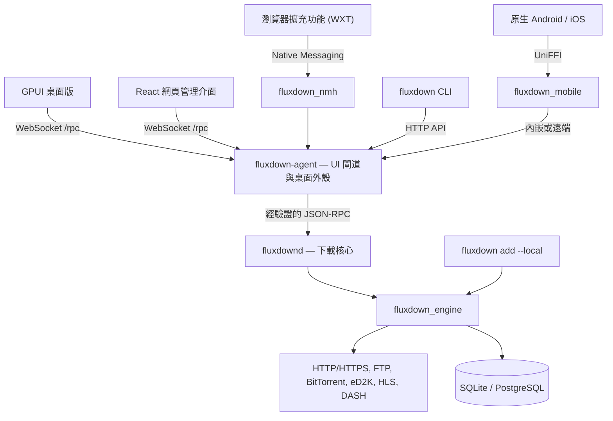

<div align="center">


# FluxDown

### 下載效能，全面提升。

*極速、多協定的下載管理工具——免費開源的 IDM 替代方案。*

[](https://github.com/zerx-lab/FluxDown/releases/latest)
[](https://github.com/zerx-lab/FluxDown/releases)
[](LICENSE)
[](#安裝)
[](native/engine)
[](crates/app)
[](mobile)
[](https://glama.ai/mcp/servers/zerx-lab/FluxDown)

[](https://github.com/rust-unofficial/awesome-rust#utilities)
[](https://github.com/thechampagne/awesome-windows#utilities)
[](https://github.com/Axorax/awesome-free-apps#download-managers)
[](https://github.com/offa/android-foss#-downloader--manager)
[](https://github.com/pcqpcq/open-source-android-apps/blob/master/categories/tools.md)
[](https://portainer-templates.as93.net/fluxdown)
[](https://github.com/selfhosters/unRAID-CA-templates/blob/master/templates/fluxdown.xml)
[](https://github.com/1c7/chinese-independent-developer)

[**官方網站**](https://fluxdown.com) · [**下載**](https://fluxdown.com/#download) · [**更新紀錄**](https://fluxdown.com/changelog) · [**常見問題**](https://fluxdown.com/faq) · [**意見回饋**](https://fluxdown.com/feedback)

[English](README.md) | [简体中文](README.zh-CN.md) | **繁體中文（台灣）**

</div>

---

## 特色亮點

- **動態下載加速** — Rust + Tokio 引擎，支援自適應分段及慢速分段接管
- **多協定支援** — HTTP/HTTPS、FTP、BitTorrent、eD2K、HLS 與 DASH 串流
- **一套引擎，多種用戶端** — 原生 GPUI 桌面版、Kotlin Android 與 SwiftUI iOS App、React 網頁管理介面及 CLI
- **瀏覽器整合** — 提供 Chrome、Edge、Firefox 擴充功能，具備三層下載攔截機制，另有使用者腳本
- **支援 AI 代理程式** — 內建 MCP（Model Context Protocol）伺服器，讓 Claude、Cursor 等 AI 工具管理下載工作
- **自動化與遠端管理** — RSS 訂閱、排程佇列、Webhook、外掛程式，以及選用的 FluxCloud 裝置協作功能
- **本機優先** — 免費開源、無廣告，本機下載無須帳號；預設在本機儲存續傳狀態

## 功能

| 功能 | 說明 |
|---|---|
| **Rust 驅動的引擎** | 共用 Rust + Tokio 引擎，不依賴 UI 或 FFI，供桌面、行動裝置、伺服器與獨立 CLI 使用 |
| **智慧分段** | 執行時動態切分下載區段，由閒置的工作執行緒接手速度較慢的區段 |
| **多協定** | 支援 HTTP/HTTPS、FTP、BitTorrent（DHT/UPnP/磁力連結）、eD2K（伺服器與 Kad DHT 來源搜尋、MD4 驗證）、HLS（AES 解密）及 DASH 專用引擎 |
| **佇列與速度控制** | 具名佇列、排程，以及採用權杖桶演算法的全域速率限制 |
| **資料持久化與續傳** | 預設使用 SQLite（WAL 模式），伺服器部署可改用 PostgreSQL；可根據已儲存的狀態恢復下載 |
| **瀏覽器整合** | 下載攔截、串流媒體偵測、Alt+Click 略過攔截、右鍵傳送，以及連線診斷 |
| **桌面與網頁介面** | GPUI 桌面與 React 網頁管理介面，支援明亮／深色模式、自訂主題、工作詳細資訊及分段視覺化；關閉介面後仍可透過系統匣持續提供服務 |
| **RSS 與自動化** | 訂閱來源篩選、無人值守下載、JavaScript 外掛程式、受管理的 FFmpeg/yt-dlp 元件及工作事件 Webhook |
| **遠端裝置** | 可選用 FluxCloud 帳號、設定同步與遠端工作管理，亦支援區域網路裝置配對與直接連線 |
| **API 與 CLI** | REST/OpenAPI、相容 aria2 的 JSON-RPC、提供 12 項工具的 MCP，以及供腳本操作或獨立下載的 CLI |

**隱私權說明：** 本機下載不需要 FluxCloud 帳號；雲端功能為選用。匿名安裝統計與每日活躍使用統計由 `analytics_enabled` 控制，可自行停用，且不收集下載內容或工作資訊。本程式並非完全不收集遙測資料。

## FluxDown 與 IDM 比較

| | FluxDown | IDM |
|---|:---:|:---:|
| 價格 | **免費且開源** | $24.95，另有續約費用 |
| 開放原始碼 | 是（AGPL-3.0） | 否 |
| 支援平台 | Windows / macOS / Linux / NAS / Android | 僅 Windows |
| BitTorrent 與磁力連結 | 支援 | 不支援 |
| eD2K / eMule 連結 | 支援 | 不支援 |
| HLS / DASH 串流 | 支援 | 部分支援 |
| 動態分段 | 支援 | 支援 |
| 瀏覽器擴充功能 | Chrome / Edge / Firefox | 支援 |
| 廣告 | **無** | — |

## 安裝

請前往 [**GitHub Releases**](https://github.com/zerx-lab/FluxDown/releases/latest) 或 [**fluxdown.com**](https://fluxdown.com/#download) 下載最新版本：

| 平台 | 安裝套件 |
|---|---|
| **Windows**（x64 / ARM64） | `setup.exe` 安裝程式、可攜式 `.zip` |
| **macOS**（Intel / Apple Silicon） | `.dmg`、可攜式 `.tar.gz` |
| **Linux**（x64） | `.AppImage`、`.deb`、Arch `.pkg.tar.zst`、可攜式 `.tar.gz` |
| **Android**（arm64-v8a / armeabi-v7a / x86_64） | 各 ABI 專用 `.apk`、通用 `.apk` |
| **NAS／伺服器**（無頭模式，x64 / ARM64） | [Docker](https://ghcr.io/zerx-lab/fluxdown-server)、Synology DSM 6/7 `.spk`、QNAP `.qpkg`、OpenWrt `.apk`（25.12 以上）／`.ipk`、Unraid CA 範本、CasaOS / ZimaOS 應用程式商店 |

### 瀏覽器擴充功能

安裝擴充功能，即可讓 FluxDown 自動接管瀏覽器下載：

[](https://chromewebstore.google.com/detail/fluxdown/meleenglfggcmcajknpeeeiobnpfmahc)
[](https://microsoftedge.microsoft.com/addons/detail/fluxdown/nglkkjbogjghekbhhcnccnpfedjbdhhd)
[](https://addons.mozilla.org/firefox/addon/fluxdown)

擴充功能透過 Native Messaging 與桌面代理程式連線。此外，也提供 [Tampermonkey 使用者腳本](userscript/)。

### NAS／伺服器

目前的無頭服務由 **`fluxdown-agent --server` + `fluxdownd`** 組成，並內建網頁管理介面。Docker 映像檔仍使用名稱 `ghcr.io/zerx-lab/fluxdown-server`。

取得原始碼後，可使用隨附的 [Compose 設定檔](docker/docker-compose.yml)：

```shell
docker compose -f docker/docker-compose.yml up -d
```

開啟 `http://<server>:17800/`，並在首次啟動精靈中設定存取金鑰。金鑰必須包含 8 至 128 個可顯示的 ASCII 字元，且同時包含至少一個英文字母及一個數字。請先在可信任的網路中完成設定，再對外提供服務；遠端存取請使用 HTTPS 反向代理伺服器。

- 伺服器模式預設監聽 `0.0.0.0:17800`，可透過 `FLUXDOWN_BIND` 覆寫。
- 如需無人值守部署，請透過部署環境或秘密管理工具提供 `FLUXDOWN_TOKEN`，不要將金鑰寫入版控檔案。此變數只會在尚未設定金鑰時進行初始化。
- 請持久化儲存 `/data`（資料庫、記錄與存取金鑰）及 `/root/Downloads`（下載檔案）。隨附的 Compose 設定使用具名資料磁碟區，並將主機上的 `docker/downloads/` 作為下載目錄。
- 若下載磁碟需要休眠，建議將 `/data` 放在 SSD 或快取儲存空間。
- 原生部署時，`fluxdown-agent` 與 `fluxdownd` 必須位於同一目錄。

## CLI 與 HTTP API

`fluxdown` CLI 預設透過 HTTP API 連線至執行中的桌面或伺服器服務。桌面版必須先在「設定 → API 服務」啟用管理 API。透過 `FLUXDOWN_TOKEN` 提供存取金鑰，並使用 `FLUXDOWN_URL` 或 `--url` 指定遠端伺服器。

```shell
fluxdown ping
fluxdown add "https://example.com/file.zip"
fluxdown --json list

# 獨立模式：直接內嵌引擎，不連線至服務
fluxdown add --local "https://example.com/file.zip"
```

獨立模式不能與執行中的引擎共用資料目錄；請先停止使用該資料目錄的服務。

| 介面 | 端點 | 用途 |
|---|---|---|
| REST 管理 API | `/api/v1/*` | 工作、佇列、RSS 等管理操作 |
| OpenAPI | `/api/v1/openapi.json` | 可供機器讀取的 API 結構描述 |
| 相容 aria2 的 JSON-RPC | `/jsonrpc`（HTTP / WebSocket） | 整合相容 aria2 的用戶端 |
| MCP | `/mcp` | AI 代理程式工具 |
| 官方 UI 協定 | `/rpc`（WebSocket） | GPUI／網頁閘道；與 aria2 API 不同 |

桌面版預設使用 `127.0.0.1:17800`，管理 API 與 MCP 預設為停用，必須手動啟用。伺服器模式預設啟用兩者，並要求提供存取金鑰。REST 介面規格請參閱 [OpenAPI 規格](website-v2/public/openapi.json)。

## MCP 伺服器（Model Context Protocol）

FluxDown 內建 **MCP 伺服器**，讓 AI 代理程式（Claude Desktop、Cursor、Cline 等）透過 [Model Context Protocol](https://modelcontextprotocol.io) 管理下載工作。它在同一個 API 連接埠提供無狀態 **Streamable HTTP** 子集（透過 `POST /mcp` 傳輸 JSON-RPC 2.0），不需要額外啟動 MCP 程序。

- **端點：** 桌面版預設為 `http://127.0.0.1:17800/mcp`；無頭部署請改用伺服器位址
- **驗證：** Bearer 權杖（`Authorization: Bearer <token>` 或 `X-FluxDown-Token`），與管理 API 共用
- **啟用：** 設定 → API 服務 → 開啟 *MCP 端點*（會自動產生權杖）；無頭伺服器預設啟用

### 工具（12 項）

| 工具 | 說明 |
|---|---|
| `download_add` | 建立下載工作（HTTP/HTTPS、FTP、磁力連結、BitTorrent） |
| `download_list` | 列出工作及其進度／速度／狀態，可依狀態篩選 |
| `download_get` | 依 ID 取得單一工作 |
| `download_pause` / `download_resume` | 暫停／繼續單一工作 |
| `download_pause_all` / `download_resume_all` | 暫停／繼續所有工作 |
| `download_remove` | 移除工作，可選擇一併刪除已下載檔案 |
| `queue_list` | 列出具名佇列及其設定 |
| `rss_list` | 列出 RSS 訂閱、設定與執行狀態 |
| `rss_add` | 新增 RSS 訂閱，並依排程定期檢查 |
| `rss_remove` | 刪除 RSS 訂閱及其已收集的項目 |

### 用戶端設定

```json
{
  "mcpServers": {
    "fluxdown": {
      "url": "http://127.0.0.1:17800/mcp",
      "headers": { "Authorization": "Bearer <your-token>" }
    }
  }
}
```

MCP 層位於 [`native/api/src/mcp.rs`](native/api/src/mcp.rs)，與 REST 管理 API、相容 aria2 的 JSON-RPC 共用同一個 `ApiHost` trait。

## 系統架構

**一套 Rust 下載引擎，支援多種宿主與用戶端。** 桌面版採用 `fluxdown-desktop → fluxdown-agent → fluxdownd` 架構；無頭部署重複使用代理程式與常駐程式，搭配 React 網頁管理介面。原生 Android 與 iOS 用戶端經由 UniFFI（`native/mobile`）連接，使用內嵌代理程式與常駐程式進行本機下載，或透過 `/rpc` 連接遠端宿主。



- **由 Daemon 管理下載：** 包含引擎、下載資料庫、佇列、RSS、外掛程式及 Webhook。
- **由 Agent 管理整合功能：** 包含 UI 閘道、FluxCloud 帳號與同步、裝置協作、瀏覽器下載擷取，以及系統匣與桌面應用程式生命週期。
- **共用介面契約：** `native/protocol` 定義與傳輸方式無關的 DTO、方法及事件；`native/api` 透過 `ApiHost` 提供 REST、aria2 與 MCP，不依賴下載引擎。
- **引擎獨立性：** `EventSink` 與 `HostSelection` 負責連接引擎與宿主。同一時間只有一個引擎可寫入特定資料目錄；架構圖展示的是可替代的宿主方式，並非多個宿主同時寫入。

| 層級 | 技術 | 路徑 |
|---|---|---|
| 桌面 UI | Rust + GPUI；應用程式組裝與功能 crate | [`crates/`](crates)、[`crates/app/`](crates/app) |
| 代理程式／常駐程式 | UI 閘道與無頭宿主／下載核心 | [`native/agent/`](native/agent)、[`native/daemon/`](native/daemon) |
| 共用協定／HTTP API | JSON-RPC DTO／REST、aria2、MCP 介接 | [`native/protocol/`](native/protocol)、[`native/api/`](native/api) |
| 下載引擎 | Rust + Tokio，不依賴 UI 或 FFI | [`native/engine/`](native/engine) |
| 行動裝置 UI／橋接 | Kotlin + Jetpack Compose／SwiftUI + UniFFI | [`mobile/Android/`](mobile/Android)、[`mobile/FluxDown/`](mobile/FluxDown)、[`native/mobile/`](native/mobile) |
| 網頁管理介面 | React + TypeScript + Vite | [`web/`](web) |
| CLI | HTTP 用戶端或內嵌引擎 | [`native/cli/`](native/cli) |
| 瀏覽器整合 | WXT + TypeScript、Native Messaging、使用者腳本 | [`fluxDown/`](fluxDown)、[`native/nmh/`](native/nmh)、[`userscript/`](userscript) |
| 官方網站 | Astro + React | [`website-v2/`](website-v2) |

## 從原始碼建置

請先安裝 [Rust 工具鏈](https://www.rust-lang.org/tools/install) 與平台所需的原生建置工具（Windows 使用 MSVC，macOS 使用 Xcode 命令列工具）。Linux 桌面版另需圖形、音效與系統匣開發函式庫；Ubuntu 的維護中套件清單可參閱 [CI 設定](.github/workflows/ci.yml)。網頁管理介面需要 [Bun](https://bun.sh)。Android 需要 Android Studio 的 JBR、Android SDK/NDK 及 `cargo-ndk`；iOS 則需要 Xcode。

```shell
# 複製開發分支（main = 持續開發，stable = 穩定發行）
git clone -b main https://github.com/zerx-lab/FluxDown.git
cd FluxDown
```

### 桌面版（GPUI）

```shell
# 建置桌面 UI、代理程式、常駐程式與瀏覽器中繼元件，然後啟動
cargo desktop-dev

# 僅建置（macOS 同時產生已簽署的開發用 .app）
cargo desktop-dev --build-only
```

啟動工具會重複使用既有的桌面應用程式或服務執行個體，不會強制重新啟動。測試執行中程式碼的變更前，請先關閉 UI 並停止相關服務。

### 無頭伺服器與網頁管理介面

```shell
# 必須先建置網頁管理介面，再建置代理程式
cd web
bun install --frozen-lockfile
bun run build
cd ..

cargo build -p fluxdown_daemon
cargo run -p fluxdown_agent --features web-ui -- --server
```

編譯時，`web-ui` 功能會將 `web/dist` 內嵌至代理程式的執行檔中。修改前端後，必須先重新建置網頁管理介面，再重新建置代理程式。也可使用 `FLUXDOWN_WEBROOT` 改為從磁碟目錄提供內容。

進行前端開發時，請保持伺服器執行，並在另一個終端機執行 `cd web && bun run dev`：Vite 會監聽連接埠 5173，並將後端要求代理至連接埠 17800。

### CLI

```shell
cargo build -p fluxdown_cli
cargo run -p fluxdown_cli -- ping
```

### 原生行動裝置

Android 專案位於 `mobile/Android`；iOS 專案位於 `mobile/FluxDown`。兩者共用 `native/mobile` 的 Rust 核心，以及 `assets/i18n` 中的共用翻譯。

```shell
# Android：將 JAVA_HOME 設為 Android Studio 的 JBR 路徑
(cd mobile/Android && ./gradlew :core:testDebugUnitTest :bridge:testDebugUnitTest :app:assembleDebug)
# iOS：在 Repository 根目錄執行
mobile/FluxDown/scripts/build-core.sh
(cd mobile/FluxDown && xcodebuild build -project FluxDown.xcodeproj -scheme FluxDown -destination 'generic/platform=iOS Simulator')
```

Android 正式發行版本使用原生專案的 `ANDROID_NATIVE_*` 簽署憑證。**原生版本無法直接覆蓋安裝舊版 Flutter APK**；解除安裝舊版前，請先備份所需資料。已淘汰的 Flutter SDK、Rinf 與 hub 不再是建置必要項目。共用資源、舊版桌面資料與主題的升級相容性，以及網站的舊版主題編輯器仍獲得支援。

<details>
<summary><b>執行測試</b></summary>

```shell
cargo test -p fluxdown_engine        # 引擎測試
cargo test -p fluxdown_api           # HTTP / aria2 / MCP 介面契約
cargo test -p fluxdown_agent         # 閘道／伺服器
cargo test -p fluxdown_cli           # CLI
cd web && bun test && cd ..          # 網頁管理介面
cargo test -p fluxdown_mobile        # 共用原生行動裝置核心
```

</details>

## 貢獻與社群

- **問題回報／功能建議** — [GitHub Issues](https://github.com/zerx-lab/FluxDown/issues) 或[官方網站意見回饋頁面](https://fluxdown.com/feedback)
- **QQ 群組** — [832143651](https://fluxdown.com/qq-group)

歡迎提交 Pull Request！請從 `main` 建立分支，並以 `main` 為 PR 的目標分支。`main` 是開發分支，而 `stable` 僅用於穩定發行版本（由維護者從 `main` 同步更新）。提交前請確認以下檢查通過：

```shell
cargo fmt --check
cargo clippy --workspace --all-targets -- -D warnings
```

完整流程請參閱 [CONTRIBUTING.md](CONTRIBUTING.md)。

## 授權條款

本專案依 [GNU Affero General Public License v3.0](LICENSE) 授權散布。

<div align="center">

**如果 FluxDown 幫你節省了時間，歡迎給專案一顆 Star，讓更多人認識它。**

由 [zerx-lab](https://github.com/zerx-lab) 開發

</div>
